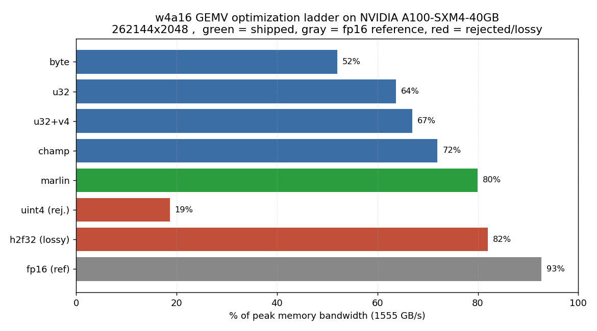

# w4a16: int4 weight-only GEMV kernels for LLM decode (CUDA, A100)

CUDA kernels for the matrix times vector product in single token LLM decoding,
with 4 bit weight quantization (int4 weights, fp16 activations). The repo keeps the
whole optimization ladder, including the versions that did not work, so each step
can be re-run.



## What it is

In decode, each layer multiplies a weight matrix by a single activation vector.
This is memory bound: the time is dominated by reading the weights, not by the
arithmetic. Quantizing the weights to int4 cuts the bytes read by 4x versus fp16.
The kernels here read int4 weights, dequantize them inside the kernel (no
dequantized matrix is written to memory), and multiply by an fp16 vector with a
per row scale.

## Results

Measured on an A100-SXM4-40GB, peak memory bandwidth 1555 GB/s. Shapes are large
decode shapes where the kernel runtime is well above the kernel launch floor (the
benchmark measures that floor and reports each result's floor fraction). Numbers
below are from the largest shape (262144 x 2048), median of several passes, GPU
clocks warmed first.

| kernel | change | % of peak | accuracy (max abs err vs reference) |
|---|---|---|---|
| byte | warp per row, 1 byte per lane | 52% | 4e-5 |
| u32 | 32 bit weight load (8 int4 per lane) | 64% | 4e-5 |
| u32+v4 | 128 bit float4 vector load | 67% | 4e-5 |
| champ | fp16 bit trick dequant, fp32 accumulate | 72% | 4e-5 |
| marlin (shipped) | lop3 dequant, interleaved packing | 80% | 4e-5 |

The shipped kernel (marlin) runs this shape in 0.216 ms versus 0.745 ms for the
fp16 kernel, a 3.4x latency reduction, at the same accuracy. The fp16 kernel
reaches 93% of peak bandwidth; the int4 kernel reaches 80% because it is compute
bound (the dequantize plus multiply arithmetic), not bandwidth bound. For decode,
the time per token is what matters, and the int4 kernel is faster there.

## How it works

The bottleneck was measured with Nsight Compute at each step and moved three
times: DRAM latency, then L1/TEX throughput, then compute. Each change targeted
the bottleneck that the profiler showed at that point.

The shipped kernel decodes 8 packed int4 weights into four half2 values using the
fp16 bit pattern: `half(0x6400 | n) - 1032 == n - 8` for a 4 bit value n. The
nibble extraction uses four `lop3.b32` instructions instead of about 24 shift,
mask, and subtract operations. This needs an interleaved weight packing (slot
order 0,2,4,6,1,3,5,7 within each group of 8 columns) so the lop3 outputs come
out in column order. The bit mapping is checked in Python and the kernel is
checked against a PyTorch reference in the test suite.

### What did not work

Kept in the tree with the measured reason:

- 128 bit weight load (uint4, 32 int4 per lane): 19% of peak. Each warp finished
  its row with too little work left, so there were too few memory requests in
  flight to cover latency.
- Shared memory staging of the activation vector: slower. The vector already hit
  in L1 at 94%, so staging it added a barrier with no bandwidth saving.
- Fast dequant applied before fixing the load path: slower. When the kernel is
  load bound, cheaper arithmetic is hidden behind the load wait, so it only helps
  after the load path is fixed.
- fp16 multiply accumulate (h2f32): 82% of peak but about 6e-2 max error versus
  4e-5. The fp16 multiply rounds each product before summing, which fp32
  accumulation cannot recover. Kept as an opt in variant, not the default.

### Why it stops at 80%

A probe that removes the unpack work (keeping the loads and the multiplies)
reaches about 85 to 88% of peak, and removing the multiplies alone reaches about
80%. So after the lop3 dequant the kernel is near the fp32 multiply add floor,
which is the arithmetic of the dot product and cannot be removed. Closing the gap
to the fp16 kernel's 93% would require fp16 multiplies, which cost about 1000x
more error, so I did not.

## Build and run (Colab, A100)

```bash
pip install ninja matplotlib          # ninja compiles the .cu at runtime
pytest -v -m "not slow"               # 25 correctness tests
python benchmarks/benchmark.py        # writes results.json
python benchmarks/plots.py            # writes ladder.png and roofline.png
```

The CUDA source is in a .cu file, compiled at import with
`torch.utils.cpp_extension.load`, so there is no setup.py build step. The
benchmark and the plots read one results.json, so the numbers and the charts
match.

## Correctness

`pytest -v` runs 25 tests: each kernel (both packings) against a PyTorch
reference at `atol=1e-3`, which is about 25x the observed 4e-5 error; the shipped
and reference int4 paths agreeing; both packing roundtrips; and an int4
quantization error check. The h2f32 variant is tested to be outside the tight
tolerance so its accuracy cost cannot regress unnoticed. A slow test (`-m slow`)
checks that all 113 `nn.Linear` layers in Llama-3.2-1B swap to the int4 module.

## Limitations

- Decode only. The module uses the kernel for the single token step (batch and
  sequence length 1) and falls back to dense fp16 for prefill.
- Quantization is symmetric with a per row scale, int4 weights, fp16 activations.
- The vectorized and marlin kernels need the column count divisible by 8.
- Numbers are specific to the A100-SXM4-40GB. Effective bandwidth uses the matrix
  bytes against 1555 GB/s.
- End to end decode throughput is not measured here. Kernel speedups do not map
  one to one to end to end, because the linear layers are one part of the step.
- The roofline plot is included but all int4 kernels share arithmetic intensity
  4.0, so they overlap on it. The bar chart (ladder.png) is the per kernel view.
